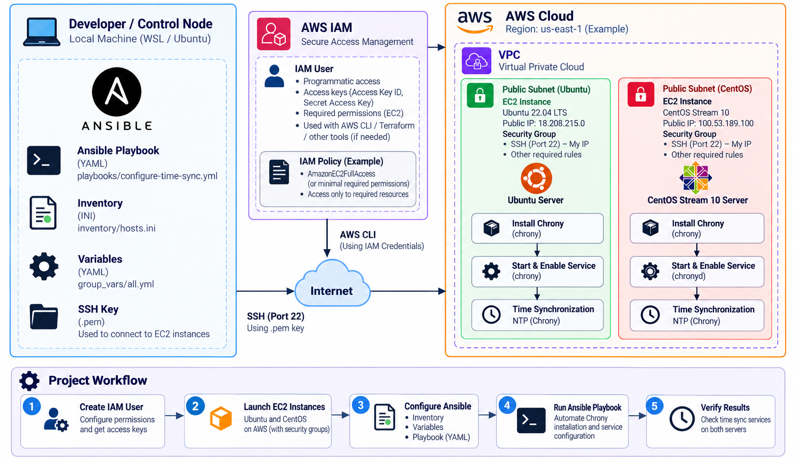

# Multi-OS Configuration Management Using Ansible on AWS

An automated configuration management project demonstrating how to manage, provision, and configure heterogeneous Linux operating systems (**Ubuntu 22.04 LTS** and **CentOS Stream 10**) on **AWS EC2** using a centralized **Ansible Control Node (WSL)**.

---

## 📌 Architecture Overview



---

## 🚀 Key Highlights & Multi-OS Handling

Managing different Linux distributions requires handling differences in package managers, package names, and systemd service daemons:

| Target System | OS Distribution | Default User | Package Manager | Package Name | Systemd Service Daemon |
| :--- | :--- | :--- | :--- | :--- | :--- |
| **Ubuntu Server** | Ubuntu 22.04 LTS | `ubuntu` | `apt` | `chrony` | `chrony` |
| **CentOS Server** | CentOS Stream 10 | `ec2-user` | `dnf` | `chrony` | `chronyd` *(daemon with 'd')* |

Ansible conditions (`when: ansible_distribution == ...`) and inventory groups allow a single unified playbook to manage both operating systems seamlessly.

---

## 🔄 Configuration Workflow


1. **Write Playbook:** Define OS-specific package installations and systemd service tasks.
2. **Define Inventory:** Configure target hosts, SSH credentials, and parent-child group hierarchies (`[linux_servers:children]`).
3. **Execute Playbook:** Run `ansible-playbook playbooks/configure-time-sync.yml`.
4. **Automate Configuration:** Ansible connects via SSH and configures both Ubuntu and CentOS servers in parallel.
5. **Verify State:** Validate service health using Ansible ad-hoc commands.

---

## 📂 Project Directory Structure

```text
Multi-OS-Configuration-Management-Using-Ansible/
├── architecture-diagram.png                        # System architecture diagram
├── README.md                                       # Project documentation
├── ansible.cfg                                     # Ansible global settings
├── inventory/
│   ├── hosts.ini                                   # Inventory file (groups, hosts, SSH keys)
│   └── group_vars/
│       └── all.yml                                 # Global variables across all inventory hosts
├── playbooks/
│   └── configure-time-sync.yml                     # Multi-OS Chrony NTP time sync playbook
├── learning/                                       # Step-by-step guides & reference commands
│   ├── aws-cli-setup.md                            # AWS CLI configuration & EC2 discovery
│   ├── ssh-key-setup.md                            # SSH key permissions & WSL path setup
│   ├── ansible-ping-test.md                        # Ad-hoc ping & verification guide
│   ├── ansible-inventory-groups.md                 # Parent-child inventory groups (:children)
│   └── service-status-verification.md              # Ad-hoc service state checks (Ubuntu vs CentOS)
└── troubleshooting/                                # Error logs and solutions
    └── group-vars-undefined-variable.md            # Fix for undefined variable / group_vars path
```

---

## 🛠️ Step-by-Step Setup & Execution

### 1. Prerequisites
- **AWS CLI:** Configured with appropriate profile credentials.
- **SSH Key:** Ensure your EC2 private key (`.pem`) has restricted permissions:
  ```bash
  chmod 400 ~/.ssh/ansible-multios.pem
  ```

### 2. Inventory Configuration
The hosts are defined in [inventory/hosts.ini](file:///c:/Users/sachintha/Desktop/Multi-OS-Configuration-Management-Using-Ansible/inventory/hosts.ini):

```ini
[ubuntu]
ubuntu-server ansible_host=18.208.215.0 ansible_user=ubuntu ansible_ssh_private_key_file=/home/sachintha/.ssh/ansible-multios.pem

[centos]
centos-server ansible_host=100.53.189.100 ansible_user=ec2-user ansible_ssh_private_key_file=/home/sachintha/.ssh/ansible-multios.pem

[linux_servers:children]
ubuntu
centos
```

### 3. Test Connectivity Across All Nodes
Verify SSH and Python environment across all Linux servers simultaneously:
```bash
ansible linux_servers -m ansible.builtin.ping
```

### 4. Execute the Multi-OS Playbook
Run the time synchronization playbook:
```bash
ansible-playbook playbooks/configure-time-sync.yml
```

### 5. Verify Service Status on Managed Nodes
Verify that the NTP service is active and running across both operating systems:

* **Ubuntu Server:**
  ```bash
  ansible ubuntu -b -m ansible.builtin.command -a "systemctl is-active chrony"
  ```
  *Expected Output:* `ubuntu-server | CHANGED | rc=0 >> active`

* **CentOS Server:**
  ```bash
  ansible centos -b -m ansible.builtin.command -a "systemctl is-active chronyd"
  ```
  *Expected Output:* `centos-server | CHANGED | rc=0 >> active`

---

## 📚 Documentation & Learning Resources

Detailed reference guides and troubleshooting notes are available in this repository:

- 📖 [AWS CLI Configuration Guide](learning/aws-cli-setup.md)
- 🔑 [SSH Key Setup in WSL](learning/ssh-key-setup.md)
- 📡 [Ansible Ping & Connectivity Guide](learning/ansible-ping-test.md)
- 👥 [Ansible Inventory Groups & Multi-OS Ping](learning/ansible-inventory-groups.md)
- ⚙️ [Multi-OS Service Status Verification](learning/service-status-verification.md)
- 🔧 [Troubleshooting: Undefined Variables & group_vars Paths](troubleshooting/group-vars-undefined-variable.md)